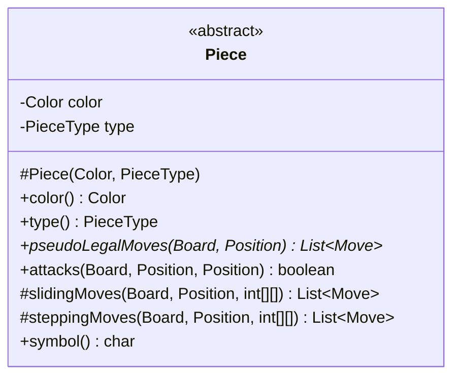
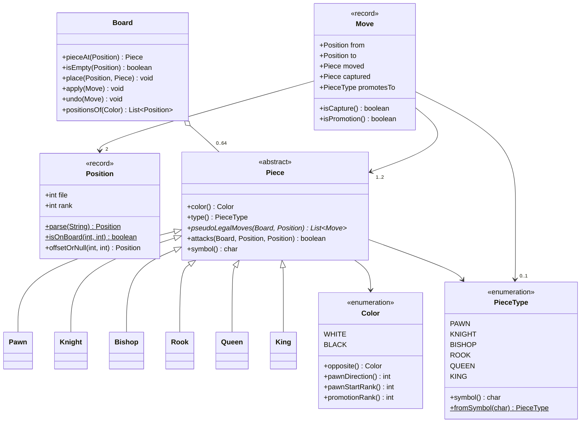
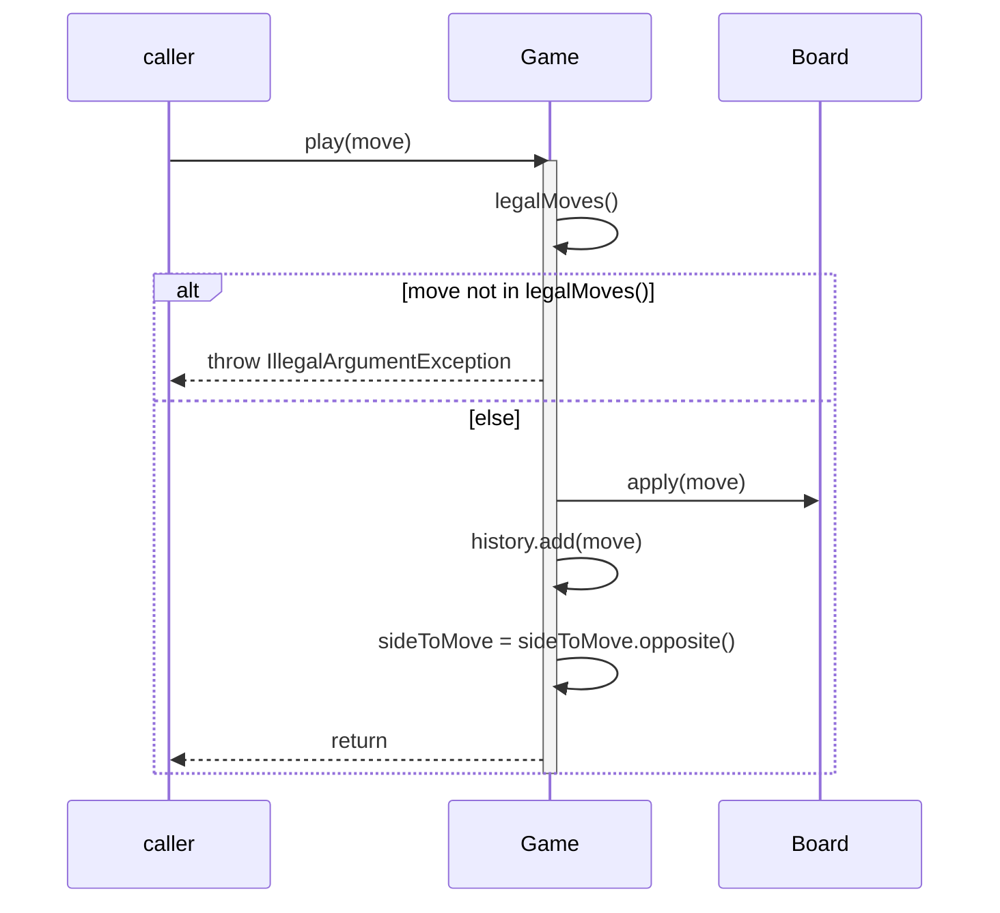
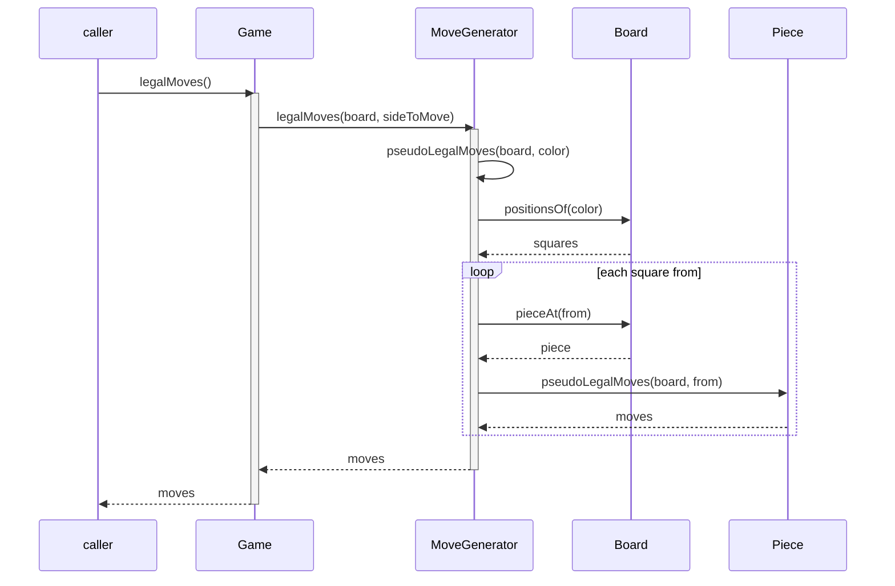
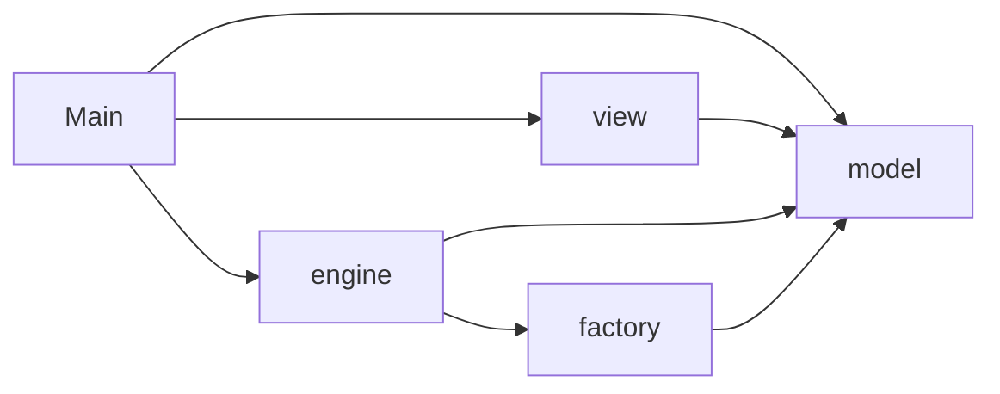
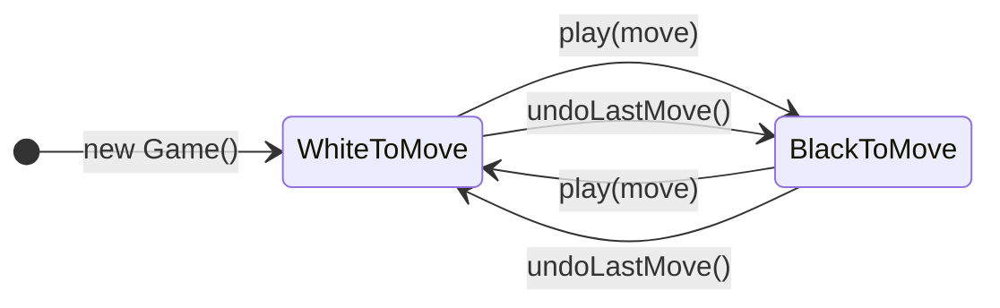

# Session 14 — UML: Class and Sequence Diagrams

**Week 10, Monday October 26 · CSC 413 Software Development**

**Objectives advanced:** 3 (analyze designs for coupling and responsibility
assignment), 9 (communicate designs with UML)

**Milestone:** M5 — king safety, check, and two diagrams of your engine.
Opens Monday October 26, due Monday November 2 at 11:59 PM.
[Read the M5 handout](../../assignments/m5-check/handout.md).

The M4 handout spent four paragraphs saying where `MoveGenerator` sits in
the engine. Here are the facts those paragraphs carried:

- it has no fields, a private constructor, and static methods;
- `Game.legalMoves()` calls it;
- `legalMoves` is public and `pseudoLegalMoves` is package-private;
- it takes a `Board` as a parameter and keeps nothing.

Here are the same facts as a class diagram:


Every fact in the list is on the picture: the `-` on the constructor, the
underlined static methods, the `~` on `pseudoLegalMoves`, the dashed arrows
that say "uses but does not keep". What the picture cannot carry is the
*reason* `MoveGenerator` exists. Diagrams show structure; prose explains it.
You need both.

The single idea of this session:

> **A diagram is a claim about the code, and it is checked against the code
> like any other claim.**

## 1. UML, and how much of it you need

The **Unified Modeling Language** is one standard notation with fourteen
kinds of diagram. Working programmers use about two of them regularly:
**class diagrams**, which show what the classes are and how they relate,
and **sequence diagrams**, which show one call travelling through the
objects. These notes cover both properly, and show two more once each:
**package** and **state** diagrams.

There are two ways to use UML. As a *blueprint*, a diagram is drawn first
and code is generated from it. As a *sketch*, a diagram is drawn to explain
a design or to check one. This course uses sketches. The code is the
design of record: when a diagram and the code disagree, the diagram is
wrong and gets fixed.

All diagrams here are written in **Mermaid**, a text notation that GitHub
draws as a picture. Each one below is shown twice: as the picture, and as
the Mermaid text that produces it. Paste the text into
[mermaid.live](https://mermaid.live) to see it drawn and to experiment.

## 2. The class box

A class is a box in three compartments: the name, the fields, the methods.


Each member starts with its **visibility**:

| Mark | Java | Example in your engine |
|---|---|---|
| `+` | `public` | `Piece.color()` |
| `-` | `private` | `Piece`'s `color` field |
| `#` | `protected` | `Piece`'s constructor, `slidingMoves` |
| `~` | no modifier (package-private) | `MoveGenerator.pseudoLegalMoves` |

Methods are written with parameter **types** only and the return type
last: `+attacks(Board, Position, Position) boolean`. Names of parameters
are allowed but rarely worth the width.

Two more marks: **italics** for abstract (the class `Piece`, and its
method `pseudoLegalMoves`, which every subclass must implement), and
**underline** for static (`MoveGenerator`'s two methods).

A diagram does not have to show every member. Show what explains the
design. Private helpers can usually be left out; public methods are the
class's contract and usually stay in. For records and enums, the
stereotype `«record»` or `«enumeration»` goes above the name.

In Mermaid:

<!-- mmd:box -->

<!-- /mmd:box -->

## 3. Six relationships

Lines between boxes say how classes relate. There are six kinds you need,
and every example below is a pair of classes from your engine.

![Six rows, each a pair of classes joined by a different line. MoveGenerator to Board, dashed line with an open arrowhead: dependency, uses it, keeps nothing. Move to Position, solid line with an open arrowhead: association, holds a reference. Board to Piece, solid line with a hollow diamond at Board: aggregation, holds parts that outlive it. Game to Board, solid line with a filled diamond at Game: composition, owns a part that dies with it. Rook to Piece, solid line with a hollow triangle at Piece: inheritance, is a kind of. Board to BoardView, dashed line with a hollow triangle at BoardView: realization, implements.](diagrams/svg/arrows.svg)

| Relationship | Line | What it is in the code | Mermaid |
|---|---|---|---|
| dependency | dashed, open arrow | a parameter, a local variable, a static call | `A ..> B` |
| association | solid, open arrow | a field | `A --> B` |
| aggregation | hollow diamond at the whole | a field holding parts that also live elsewhere | `A o-- B` |
| composition | filled diamond at the whole | a field holding a part only the whole uses | `A *-- B` |
| inheritance | hollow triangle at the parent | `extends` | `Parent <\|-- Child` |
| realization | dashed, hollow triangle at the interface | `implements` | `Interface <\|.. Class` |

The first four are "has" or "uses" relationships and run from weakest to
strongest. To choose among them, ask two questions about class `A` and the
class `B` at the other end:

1. **If `B` changes, does `A` have to change?** If yes, there is some
   arrow from `A` to `B`. That is coupling, from session 9, drawn.
2. **How long does `A` hold on to `B`?** Only during a call: dependency.
   In a field: association. In a field, as one of many parts that also
   exist elsewhere: aggregation. In a field, as a part no one else uses:
   composition.

The last two are "is a" relationships. The triangle always points at the
parent or the interface.

### Your engine, arrow by arrow

**`Game` and `Board`: composition.** `Game` has the field
`private final Board board`, so it is at least an association. It is
composition because of what `Game` promises: once a game exists, only
`Game` changes its board, through `play` and `undoLastMove`. Session 12
listed that as one of `Game`'s invariants.

There is an honest objection. `Game(Board, Color)` accepts a board from
the caller, and the caller may still hold a reference to it. In the code,
nothing stops that caller from changing the board later, and session 12's
`board()` handed the reference out as well. Composition here records the
design's intent; the code enforces it only as far as you made it. A
diagram can be right about the design and still point you at a place
where the code is weaker than the design.

**`Game` and `MoveGenerator`: dependency.** `Game` has no field of type
`MoveGenerator`. It calls one of `MoveGenerator`'s static methods and
keeps nothing afterwards. `MoveGenerator` can never be instantiated, so nothing can
hold one in a field, and the only arrow that can point at it is a
dependency. If you ever find yourself drawing an association to
`MoveGenerator`, look for the field that should not be there.

**`Board` and `Piece`: aggregation.** The board holds up to sixty-four
pieces. When a piece is captured it leaves the board, but the object is
not gone: `Move.captured` still refers to it, and `Board.undo` puts that
same object back. The parts outlive their place in the whole. That is the
difference between aggregation and composition, and it is the reason
M3's `undo` needed no bookkeeping.

**`Move` and `Piece`: association.** `Move` is a record with the
components `moved` and `captured`, both of type `Piece`. A field is an
association.

**`TextBoardRenderer` and `Board`: dependency.** `render(Board)` takes the
board as a parameter, draws it, and keeps nothing.

**`Rook` and `Piece`: inheritance.** `Rook extends Piece`.

**`Board` and `BoardView`: realization**, if you added session 12's
read-only view after M4. `Board implements BoardView`.

### Multiplicity

A number at the end of a line says how many of the far class one object
refers to:

| Multiplicity | Means | In your engine |
|---|---|---|
| `1` | exactly one | (the default when nothing is written) |
| `0..1` | zero or one | a `Move`'s `promotesTo`: null unless a pawn promotes |
| `2` | exactly two | a `Move`'s `from` and `to` |
| `1..2` | one or two | a `Move`'s `moved`, plus `captured` if it captures |
| `0..64` | up to sixty-four | the pieces on a `Board` |
| `*` | any number | |

## 4. The `model` package

Every class in `model`, its public methods, and every relationship. This
is half of the class diagram M5 asks for; the `engine` half is yours to
add.

![Class diagram of the model package. Move, a record with fields from, to, moved, captured, and promotesTo, has arrows to Position labelled 2, to Piece labelled 1..2, and to PieceType labelled 0..1. Board, with pieceAt, isEmpty, place, apply, undo, and positionsOf, joins Piece with a hollow diamond at Board labelled 0..64. Piece, abstract, with color, type, pseudoLegalMoves in italics, attacks, and symbol, has arrows to the enumerations Color and PieceType. Six classes, Pawn, Knight, Bishop, Rook, Queen, and King, share one inheritance triangle pointing at Piece. Position, a record with file and rank, has static parse and isOnBoard and the method offsetOrNull.](diagrams/svg/model.svg)

<!-- mmd:model -->

<!-- /mmd:model -->

Check it against your own code, not against this page. Some things to
look at:

- **`Move`'s five components.** Each one that holds a class from `model` is
  an arrow. `promotesTo` is a `PieceType`, not a `Piece`.
- **`Board`'s methods.** If you wrote a private helper for promotion in
  M3, it is private and may be left out. If your `Board` calls
  `PieceFactory` instead, that is an arrow from `model` to `factory`, and
  it belongs in the diagram: session 9 named it as the cost of that
  choice.
- **The six subclasses** may be drawn without methods; they all have
  `pseudoLegalMoves`, and `Pawn` also overrides `attacks`.
- **`Piece` and `Board` refer to each other.** `Board` holds pieces;
  `pseudoLegalMoves(Board, Position)` takes a board as a parameter. The
  second is a dependency from `Piece` to `Board`. It is left out above to
  keep the drawing readable, which is a choice a sketch is allowed to make
  as long as nothing it does show is false.

### One Mermaid trap: the tilde

```
+legalMoves(Board, Color)$ List~Move~
~pseudoLegalMoves(Board, Color)$ List~Move~
```

Mermaid uses `~` for two things. Around a type, `List~Move~` is how it
writes `List<Move>`, because `<` and `>` mean something else in its
syntax. At the start of a member, `~` means package-private. `$` at the
end of a method means static, and `*` means abstract.

## 5. Sequence diagrams

A class diagram is true at every moment the program runs. A **sequence
diagram** shows one run of one method: one call, followed through the
objects it touches, in order.

- A **lifeline** is one object: a box at the top and a dashed line down.
  Time runs down the page.
- An **activation bar**, the thin rectangle on a lifeline, shows that the
  object is running a method.
- A **call** is a solid line with a filled arrowhead. A **return** is a
  dashed line with an open arrowhead.
- A call from an object to itself loops back to its own lifeline.
- **Fragments** are frames around a group of messages: `loop` repeats it,
  `alt` chooses one of several branches (an if/else), and `opt` runs it or
  not (an if with no else). The condition goes in square brackets.

### `game.play(move)`

This is M3's `play`, which session 12 showed in full: the guard, then
three lines.


<!-- mmd:play -->

<!-- /mmd:play -->

Read it top to bottom and it is the method body. The `alt` frame is the
guard. The order inside the `else` branch matters: `apply` happens only
after the guard has passed, which is the whole reason `play` exists
instead of callers using `board().apply`.

### `game.legalMoves()` after M4

After M4, `Game` asks `MoveGenerator`, which walks the board and asks each
piece.


<!-- mmd:legalmoves-m4 -->

<!-- /mmd:legalmoves-m4 -->

One `Piece` lifeline stands for all of them. The diagram does not care
which subclass answers `pseudoLegalMoves`, and neither does the loop: that
is polymorphism, from session 6, drawn.

M5 changes this diagram. Drawing the version after M5 is part of M5.

## 6. Two more kinds, once each

### Package diagram

The four packages and `Main`, with an arrow wherever one imports another.
This is session 9's drawing in UML notation.


<!-- mmd:packages -->

<!-- /mmd:packages -->

Every arrow points toward `model`, and none leaves it. That is why
`Board.java` can be read without opening any other file of yours. Check
the drawing against your own `import` lines; if you have an arrow out of
`model`, it shows up here first.

### State diagram

A **state diagram** shows the states an object can be in and the events
that move it between them. A `Game` is always in one of two states:
white to move or black to move.


<!-- mmd:turn -->

<!-- /mmd:turn -->

Check it against the code and it is incomplete. `undoLastMove()` with an
empty history returns `Optional.empty()` and changes nothing, so the turn
does not flip. The undo transitions need a **guard**, a condition in
square brackets: `undoLastMove() [history not empty]`. A diagram checked
against the code finds these gaps; that is what it is for.

A class whose behavior depends on a state like this is the subject of the
State pattern, in session 15.

## 7. Keeping diagrams true

Code changes and a drawing does not. A diagram in a slide deck or an image
file goes stale without anyone noticing.

Keeping diagrams as Mermaid text in the repository, in `docs/design.md`,
changes that. GitHub draws a fenced block that starts with ` ```mermaid `
as a picture, and the text is diffed and reviewed with the code. A commit
that adds a field to `Game` and does not touch the class diagram shows up
in review as a commit that forgot something.

## 8. What M5 asks for

In `docs/design.md`, after the code:

- a **class diagram** of `engine` and `model`, with every class, its
  public methods, and every relationship drawn with the right arrow;
- a **sequence diagram** of `game.legalMoves()` as your code runs it after
  M5.

Both are graded against your code, in both directions: an arrow the code
does not have costs as much as one the diagram is missing. The handout
lists exactly which relationships the class diagram must show.

## Exercises

1. Add the `engine` package to the `model` diagram above: `Game`,
   `MoveGenerator`, and the arrows from each to `model`. Which arrow from
   `Game` is composition, and which are associations?
2. Draw `game.findLegalMove("e2e4")` as a sequence diagram. Where does it
   need an `alt` or an `opt`?
3. Draw `game.undoLastMove()` as a sequence diagram, including the empty
   history. What does the method return in each branch?
4. `TextBoardRenderer` has the constructor
   `TextBoardRenderer(PieceGlyphs glyphs)`. What is the relationship from
   `TextBoardRenderer` to `PieceGlyphs`, and what in the code decides it?
5. Draw the state diagram for a `Position` record. What is wrong with the
   question?

## Exit question

> Draw the arrow between `Game` and `Board`, and the arrow between
> `MoveGenerator` and `Board`. In one sentence, say why they are different
> arrows.

**Related material:** [M5 handout](../../assignments/m5-check/handout.md),
[session 12 notes](../session-12-information-hiding/notes.md) on `Game`'s
invariants and `BoardView`,
[session 9 notes](../session-09-cohesion-coupling/notes.md) §3 on package
coupling, [Mermaid class diagrams](https://mermaid.js.org/syntax/classDiagram.html),
[Mermaid sequence diagrams](https://mermaid.js.org/syntax/sequenceDiagram.html).

---

## Appendix: midterm recap

Twenty-eight exams, scored out of 100. The figures cover all sixteen
questions, including the hand-graded essays and question 16.

| Mean | Median | Min | Max |
|---|---|---|---|
| 69.6 | 70.8 | 27.1 | 96.5 |

| Score | Below 50 | 50s | 60s | 70s | 80s | 90+ |
|---|---|---|---|---|---|---|
| Exams | 4 | 3 | 7 | 6 | 1 | 7 |

If your score is below 50, come to office hours this week and we will go
through the exam question by question.

### What went well

Ranked by the share of points the class earned on each question.

| Q | Topic | Class average |
|---|---|---|
| 3 | Equality in collections | 93% |
| 1 | Value, identity, or closed set | 85% |
| 8 | Encapsulation and invariants | 85% |
| 4 | Collections | 83% |
| 15 | Inheritance and polymorphism | 82% |

Three misses inside these are worth fixing:

- **Q4.** Ten exams counted `new Point(1, 2)` twice in the `HashSet`. A
  record's `equals` compares fields, so the two copies are one element and
  the set has size 2.
- **Q8.** Eight exams said `setTotalCents(0)` keeps the invariant. On a cart
  that holds an item, the total no longer matches the items; the setter
  should be deleted, so the cart is the only thing that changes its total.
- **Q15.** Eight exams printed `woof` for the `Puppy`. `Puppy.describe` calls
  `super.describe()`, which calls `sound()`, and dynamic dispatch picks
  `Puppy.sound()`: `Rex says yip!`.

### The five that cost the most

| Q | Topic | Class average |
|---|---|---|
| 12 | Dependencies | 44% |
| 9 | Composition or inheritance | 50% |
| 16 | Write the code: the Archer | 54% |
| 13 | Smells | 55% |
| 7 | Checked exceptions | 73% |

#### Q12: dependency injection and dependency inversion

`OrderService` created its own `MySqlOrderDatabase`, so no test could run it
without MySQL. Give the field an interface type and pass the object in
through the constructor:

```java
public interface OrderRepository {
    void save(Order order);
}

public class OrderService {
    private final OrderRepository orders;

    public OrderService(OrderRepository orders) {
        this.orders = orders;
    }

    public void placeOrder(Order order) {
        orders.save(order);
    }
}
```

A test now passes a fake `OrderRepository` that stores orders in a list.

The two terms name different things. **Dependency injection** is a
technique: a class receives its dependency instead of creating it.
**Dependency inversion** is a principle: high-level code depends on an
abstraction, not on a concrete class. Passing a `MySqlOrderDatabase` into
the constructor is injection without inversion. The `<p>` tags in the
returned string were presentation, a concern that belongs to whatever shows
the result.

#### Q9: a stack is not a list

`Stack extends ArrayList` inherits every list method, so a caller can write
`stack.add(0, x)` and put an item under the top, or call `remove(0)`,
`set(i, x)`, or `sort`. `push` and `pop` do not count as the answer to (a):
they are the stack's own methods. Composition keeps the list as a private
field and exposes only the stack's operations:

```java
public class Stack<T> {
    private final List<T> items = new ArrayList<>();

    public void push(T item) { items.add(item); }
    public T pop() { return items.remove(items.size() - 1); }
}
```

Part (b) had three parts: the field, `push` and `pop` delegating to it, and
callers no longer reaching any list method. In this session's terms, the
inheritance arrow becomes an association.

#### Q16: the Archer

```java
import java.util.List;

public class Archer extends Piece {

    private static final int[][] JUMPS =
        {{0, 2}, {0, -2}, {2, 0}, {-2, 0}};

    public Archer(Color color) {
        super(color, PieceType.ARCHER);
    }

    @Override
    public List<Move> pseudoLegalMoves(Board board, Position from) {
        return steppingMoves(board, from, JUMPS);
    }
}
```

Twelve of 28 answers had no constructor. `Piece` has no no-argument
constructor, so a subclass must declare one and call `super` with a color
and a type; without it, `Archer` does not compile. Fifteen had all four
offsets, and fourteen called `steppingMoves`. A jump of two squares is a
step with a longer offset: `steppingMoves` already skips squares off the
board and squares holding a friendly piece, and it never looks at the square
in between. It is the same shape as your `Knight`.

#### Q13: smells in `calc`

| Smell | Change |
|---|---|
| The type is a string, `"MANAGER"` | An enum, `EmployeeType` |
| An `if` chain on the type | The multiplier stored on each enum constant |
| `println` inside a calculation | Return the total; the caller prints |
| `calc`, `l`, `t`, `e` | Names that say what they hold |

```java
public enum EmployeeType {
    MANAGER(1.2), ENGINEER(1.1), STAFF(1.0);

    private final double multiplier;

    EmployeeType(double multiplier) {
        this.multiplier = multiplier;
    }

    public double pay(double salary) {
        return salary * multiplier;
    }
}
```

The loop body becomes `total += employee.type().pay(employee.salary());`,
and adding a type is one new constant with no new branch. Part (a) asked
for each problem together with its change; a problem named without a change
earned half.

#### Q7: catching the wrong exception

`Files.readString` throws `IOException`, which is checked: `load` must catch
it or declare it. Declaring `throws IOException` compiles, and so does
catching `IOException`. Catching `IllegalArgumentException` does not: a
`catch` block handles only the exceptions it names, so the `IOException` is
still neither caught nor declared. Eleven exams marked that one as
compiling. `IllegalArgumentException` is unchecked, so the compiler never
requires it to be caught.
