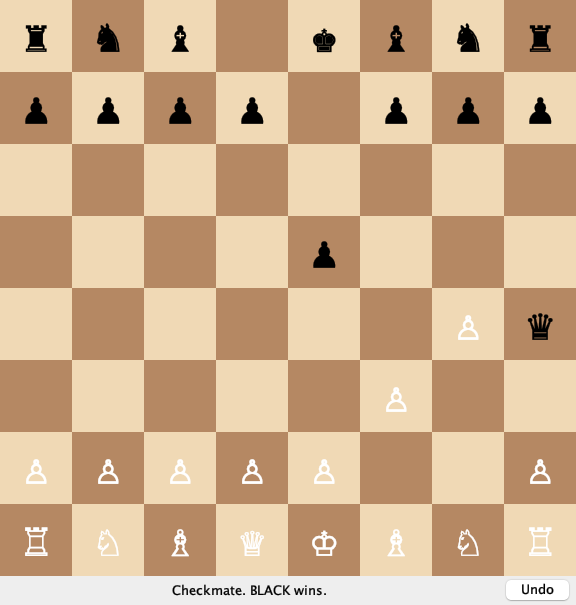
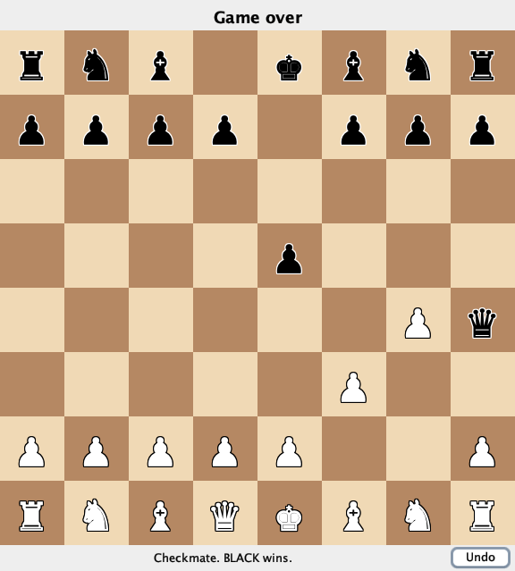
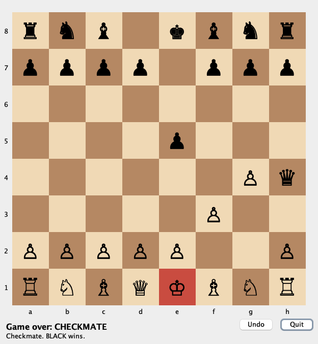

# Session 17 — Working with a coding agent

Monday split code into model, view, and controller, and gave three tests
of a good split. Today the view is written by a coding agent, and the
question is how to make it fit and how to know it does. The answer has
three parts, and none of them is about chess: tell the agent what to do
and what not to do, in writing; check its work with checks you can run;
keep only what you can explain.

## 1. Where we are

| | Our engine | Who writes it |
|---|---|---|
| **Model** | `Game` and everything behind it | you, M1–M6 |
| **Controller** | `GameController` | you, M6 |
| **View** | `BoardView`: `ConsoleView`, `EmojiView`, … | given in M6; **generated in M7** |

Monday's tests become today's checks:

- **The model runs with no screen:** the tests still pass.
- **A new view changes nothing else:** `git diff --stat` shows the new
  view and `Main`.
- **The view never changes the model:** no `game.play(` in the view.
- **A window never waits inside a click:** its `start` returns.

Each one can be run without trusting what the agent says it did.

## 2. Chat or coding agent

| | A chat | A coding agent |
|---|---|---|
| Sees | what you paste | your repository |
| Changes files | you copy its answer in | it edits them |
| Runs the build and tests | you do | it does, and reads the result |
| Can change a file you didn't mean | only if you paste it | yes |

A coding agent runs on your machine, inside your project: Codex
(OpenAI), Claude Code, GitHub Copilot's agent mode, Gemini CLI, and
others. Most have a free tier or a student plan; use the one you have.
The steps below are the same in each.

The goal in M7 is a coding agent run in your repository. A chat is
allowed, and the checks are the same; you do the copying and the running
yourself.

What makes an agent useful is also what makes instructions necessary: it
can edit any file it can read.

## 3. What to do, and what not to do

**A wish.** Before class, an agent was given an engine at the M6 state
and one sentence: "Add a GUI to my chess game." Its diff:

```
 src/main/java/edu/sfsu/csc413/chess/Main.java      |   4 +-
 .../java/edu/sfsu/csc413/chess/view/SwingView.java | 182 +++++++++++++++++++++
 2 files changed, 185 insertions(+), 1 deletion(-)
```

It broke no rule: it implemented `BoardView` and changed only `Main`. It
read `BoardView`'s comments, which explain the seam, and followed them.
Nothing required it to. Another run, or another agent, might have edited
`Game` or the controller, and nothing would have stopped it.

Its report ended: "It compiles, and the existing tests pass. I never
opened the window." The tests test the model and the controller, not the
window. Opened, the window works, and its white pieces are hard to see on
the light squares:



You find that kind of problem only by running the program.

**Instructions in a file.** Write down what the agent should do, what it
must not do, how it checks its own work, and when to stop. Put it in a
file in the repository and commit it, so every session starts from the
same rules. This is the file used in class:

```markdown
# Instructions for coding agents

This is a chess engine built with MVC. The model and the controller are
written by hand and are finished. Your job is views only.

## Do

- Add views as new classes in `src/main/java/edu/sfsu/csc413/chess/view/`
  or a new package under it.
- Implement the `BoardView` interface. Read it, `ConsoleView`, and
  `PlayerAction` before writing anything.
- Read the game only through `Game`: `board()`, `sideToMove()`,
  `legalMoves()`, `status()`, `history()`.
- Send every player action to the controller as a `PlayerAction`:
  `controller.handle(new PlayerAction.Move("e2e4"))`.
- Add one `case` to `Main.chooseView` so the new view can be chosen from
  the command line.

## Don't

- Don't change anything in `model/`, `engine/`, or `factory/`.
- Don't change `BoardView`, `PlayerAction`, `GameController`,
  `ConsoleView`, or `EmojiView`.
- Don't call `game.play`, `game.undoLastMove`, or anything that changes
  the game. Only the controller changes the game.
- Don't work out a chess rule in the view. Legal moves come from
  `game.legalMoves()`; check and checkmate come from `game.status()`.
- Don't wait for input inside a click handler. A window's `start` builds
  the window and returns; it never calls `controller.runLoop()`.
- Don't add dependencies to `pom.xml`. Swing is part of the JDK.

## Check your work

- `./mvnw test` passes, with no test changed or deleted.
- `git diff --stat` lists only new files under `view/` and `Main.java`.

## Stop and ask

If you think a file under "Don't" has to change, stop and explain why
instead of changing it.
```

Each "Don't" is one of Monday's rules, written for a reader who has
never heard them. "Stop and ask" matters most: an agent that can't do the
job within the rules should say so instead of editing the controller.
Section 5 shows one line of this file that needed fixing.

**Where the file goes:**

| Agent | Reads |
|---|---|
| Codex, Copilot, Gemini CLI, and most others | `AGENTS.md` in the project root |
| Claude Code | `CLAUDE.md`; one line, `@AGENTS.md`, includes the other |
| A chat | nothing: paste it at the top of your message |

Check your agent's documentation for the exact name. The habit carries
over to any project where an agent works in the codebase.

## 4. Reviewing what an agent wrote

Four excerpts from a generated view, written for this exercise. Three
break one of Monday's rules.

```java
// A
void squareClicked(Position target) {
    Optional<Move> move = game.findLegalMove(selected.toString() + target);
    move.ifPresent(game::play);
    repaint();
}

// B
List<Position> knightTargets(Position from) {
    int[][] jumps = {{1, 2}, {2, 1}, {2, -1}, {1, -2},
                     {-1, -2}, {-2, -1}, {-2, 1}, {-1, 2}};
    List<Position> targets = new ArrayList<>();
    for (int[] jump : jumps) {
        Position to = from.offsetOrNull(jump[0], jump[1]);
        if (to != null) {
            targets.add(to);
        }
    }
    return targets;
}

// C
public void start(GameController controller) {
    this.controller = controller;
    buildWindow();
    controller.runLoop();
}

// D
List<Position> targetsOf(Position from) {
    List<Position> targets = new ArrayList<>();
    for (Move move : game.legalMoves()) {
        if (move.from().equals(from)) {
            targets.add(move.to());
        }
    }
    return targets;
}
```

| | Rule | Caught by |
|---|---|---|
| A | the view changes the model | searching for `game.play` |
| B | the view works out a rule, and gets it wrong: no pins, no occupied squares | reading; a pinned knight lights up |
| C | a window waits for input | running it: `nextAction()` throws |
| D | fine: it asks the model | — |

A skips the controller, so nothing redraws the other views or announces
checkmate. C fails as soon as the window opens, because `BoardView`'s
default `nextAction` throws for a view that does not answer it. D is
Monday's highlighting example.

Review is more than the rules. From the wish run:

```java
String turn = game.sideToMove() == edu.sfsu.csc413.chess.model.Color.WHITE
        ? "White" : "Black";
status.setText(turn + " to move"
        + (game.status().name().equals("CHECK") ? " (check)" : ""));
```

It works. Compare the enum itself, `game.status() == GameStatus.CHECK`:
a misspelled string compiles and never matches; a misspelled constant
does not compile. Generated code is often correct and clumsy. You may fix
it, and you have to understand it either way.

## 5. Comparing runs

The same request, run twice before class:

> Add a graphical 2D view of the board using Swing. I want to play by
> clicking a piece and then clicking the square to move it to. Show whose
> turn it is and messages like check or illegal moves. Follow AGENTS.md.

Same engine, same `AGENTS.md`, each run on its own branch in a fresh
session. One change: the model behind the agent. Both passed every check:
tests green, diff only under `view/` and `Main`.





| | Run 1 | Run 2 |
|---|---|---|
| Classes | `SwingView` (234 lines) | `SwingView` + `BoardPanel` for drawing (498 lines) |
| Board | pieces only | coordinates, legal-move dots, king tinted in check |
| Promotion | always a queen | a row of buttons in the window |
| Buttons | Undo | Undo, Quit; closing the window quits |
| Top line after mate | "Game over" | "Game over: CHECKMATE" |

Run 2 does more and is twice the size. Bigger is not better by itself:
every line you keep is a line you must be able to explain.

**Instructions are read literally.** Run 2's report explained its
promotion buttons: "No modal `JOptionPane`: it waits for input inside a
click handler, which AGENTS.md forbids." A modal dialog that asks one
question is the normal Swing way to ask which piece a pawn becomes, and
the wish run used one. The rule was written about the game loop. Run 2
obeyed the wording, not the intent. When an agent follows a rule in a way
you didn't mean, fix the rule:

```markdown
- Don't wait for the next move inside the window: a window's `start`
  builds the window and returns; it never calls `controller.runLoop()`.
  A modal dialog that asks one question, such as a promotion piece, is
  fine.
```

**Keeping runs apart:**

```bash
git switch main
git switch -c m7-run-2
# start a new agent session, same AGENTS.md, one change
```

- **A branch per run**, so each diff stands alone.
- **A fresh session per run**, so nothing from the last run leaks into the
  next. The instructions file is the only thing they share.
- **One change per run:** the model, or one instruction, not both. Change
  two things and you can't say which made the difference.

## 6. M7: how it works

M7 opens Monday, November 9, and is due Monday, November 16. The handout
is posted Monday.

| Generated by an agent | Not changed |
|---|---|
| A Swing view: a 2D board you play by clicking | `model/`, `engine/`, `factory/` |
| At least one other view | `GameController` |
| Tests for the views, if you want them | `BoardView`, `PlayerAction` |

The acceptance test is Monday's test 2: the diff is new view files and
`Main`. Your own `AGENTS.md` is part of the work. Start from the one in
section 3 and change it as you learn.

**Groups of 1–3.** You choose your group. Everyone keeps their own
repository and submits individually.

- **In a group:** give each other read access, read each other's
  generated views, and compare. Adopt at least one idea from a groupmate,
  rewritten by you and cited.
- **Alone:** at least three runs, each on its own branch in a fresh
  session, with one change each. Compare your own runs.

Name your groupmates in `m7-submission.md`; that is the sign-up.

**`m7-submission.md`:**

- your `AGENTS.md` and the requests you gave;
- what you checked and kept, changed, or rejected, with file and line;
- the comparison: what differed and which you kept;
- what you took from a groupmate, and from whom.

It is also your AI-use disclosure under the syllabus. Specific beats long:
a file and line number shows you read the code.

## 7. You own what you keep

The syllabus rule: if you can't explain it, it doesn't count as yours.
You will explain your view in the final defense (M10).

A test you can run on yourself: change one behaviour in the view by hand,
without the agent. Make the board draw from black's side, or change the
highlight colour. If you can't, read the class until you can.

## Exercises

1. **Your instructions.** Write the `AGENTS.md` for your own repository.
   Which "Don't" lines change because your engine differs from the
   reference (a different package, a renamed method, the read-only
   board)?
2. **A check for each rule.** For each "Don't" in section 3, write the
   command or the action that would show it was broken. Which ones can
   only be checked by reading or running?
3. **Fix B.** Rewrite excerpt B so the view asks the model. How many lines
   does it lose?
4. **Two changes at once.** A classmate's run 2 used a different model and
   a longer `AGENTS.md`, and its view is better. What can they conclude?
   What would you do next?
5. **A rule read literally.** Find another line in section 3's
   `AGENTS.md` that an agent could obey in a way you didn't mean. Rewrite
   it.

## Exit question

> Monday's weather app gets a web page, written by a coding agent. Write
> one "do" and two "don't" lines for its instructions, and one check you'd
> run on its work.

## Related material

- [Session 16 notes](https://goleador.github.io/CSC413/guide.html?d=lectures/session-16-mvc/notes):
  the three questions, the dependency rule, the three tests, and §8's
  checks for a generated view.
- [M6 handout](https://goleador.github.io/CSC413/guide.html?d=assignments/m6-controller/handout):
  `BoardView`, `PlayerAction`, and the controller the views talk to.
- The [syllabus](https://goleador.github.io/CSC413/guide.html?d=Syllabus):
  the generative AI policy and comparison groups.
