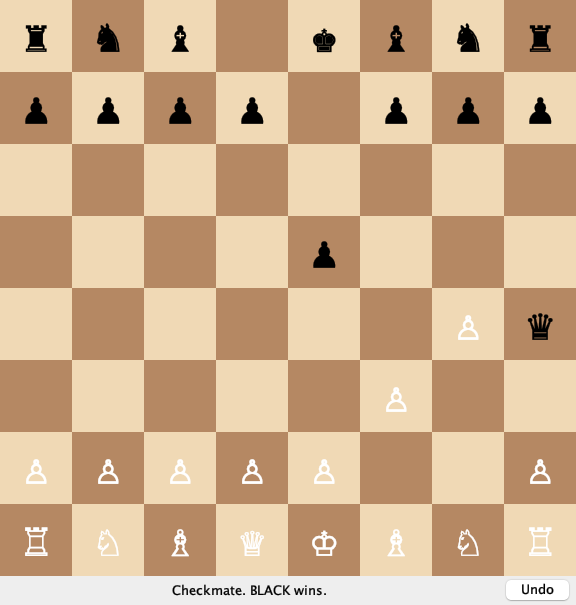
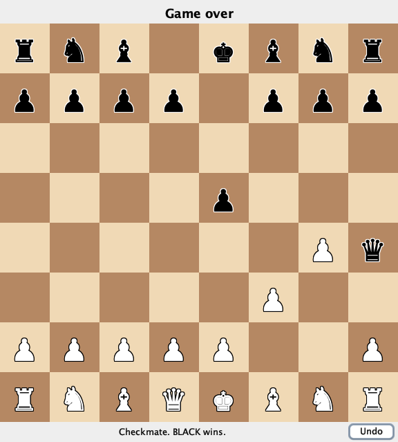
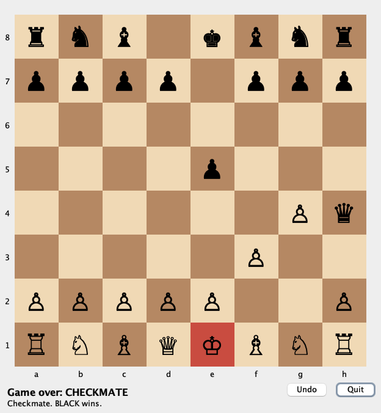

**CSC 413 · Week 11 · Wednesday Nov 4 · on Zoom**

# Working with a coding agent

### Instructions, checks, and comparisons, on any project, then in M7

San Francisco State University

> Answer questions in the Zoom chat. M6 is due Monday at 11:59 PM.

---

## Monday's split
|  | Our engine | Who writes it |
|---|---|---|
| **Model** | `Game` and everything behind it | you, M1–M6 |
| **Controller** | `GameController` | you, M6 |
| **View** | `BoardView`: `ConsoleView`, `EmojiView`, … | given in M6; **generated in M7** |

> Monday we sorted code into three roles. Today the view gets written by a coding agent, and the other two must not change when it arrives.

---

## Monday's tests are today's checks
- **The model runs with no screen**: the tests still pass.
- **A new view changes nothing else**: `git diff --stat` shows the new view and `Main`.
- **The view never changes the model**: no `game.play(` in the view.
- **A window never waits inside a click**: its `start` returns.

> These are the same four checks from Monday's last section. Every one can be run without trusting what the agent says it did.

---

# Chat or coding agent

> Two ways to get code from a model. M7 asks for the second.

---

## Two ways to get generated code
|  | A chat | A coding agent |
|---|---|---|
| Sees | what you paste | your repository |
| Changes files | you copy its answer in | it edits them |
| Runs the build and tests | you do | it does, and reads the result |
| Can change a file you didn't mean | only if you paste it | **yes** |

> An agent runs on your machine, inside your project. That is what makes it useful and what makes instructions necessary: it can edit any file it can read.

---

## Use the one you have
- Codex (OpenAI), Claude Code, GitHub Copilot's agent mode, Gemini CLI, and others.
- Most have a free tier or a student plan.
- The steps today are the same in each.

*(reveal)* M7's goal is a coding agent run in your repository. A chat is allowed; the checks are the same.

> I'll use Claude Code today because it's what I have set up. Use whichever you can get. If you only have a chat, you do the copying and the running yourself.

---

# What to do, and what not to do

> First, what happens with no instructions at all.

---

## A wish

> Add a GUI to my chess game.

An agent, on an engine at the M6 state, before class:

```
 src/main/java/edu/sfsu/csc413/chess/Main.java      |   4 +-
 .../java/edu/sfsu/csc413/chess/view/SwingView.java | 182 +++++++++++++++++++++
 2 files changed, 185 insertions(+), 1 deletion(-)
```

Did it break a rule?

*(reveal)* No. It implemented `BoardView` and changed only `Main`. Nothing required it to.

> Ask in the chat first. It stayed in its lane because BoardView's comments explain the seam, and it read them. Another run, or another agent, may not.

---

## What it said, and what it didn't do



"It compiles, and the existing tests pass. I never opened the window."

*(reveal)* The tests don't test the view.

*(reveal)* Opened: white pieces are hard to see on light squares.

> This is the agent's own report. Passing tests told us the model still works; they said nothing about the window. You find this kind of problem only by running it.

---

## What would you tell the agent?

Write one line you'd add to "Add a GUI to my chess game."

In the chat. Two minutes.

> Collect answers and sort them out loud into do, don't, and check. Expect "use Swing", "don't change the model", "make sure tests pass".

---

## `AGENTS.md`: do

```markdown
# Instructions for coding agents

This is a chess engine built with MVC. The model and the controller are
written by hand and are finished. Your job is views only.

## Do
- Add views as new classes in `src/main/java/edu/sfsu/csc413/chess/view/`
  or a new package under it.
- Implement the `BoardView` interface. Read it, `ConsoleView`, and
  `PlayerAction` before writing anything.
- Read the game only through `Game`: `board()`, `sideToMove()`,
  `legalMoves()`, `status()`, `history()`.
- Send every player action to the controller as a `PlayerAction`:
  `controller.handle(new PlayerAction.Move("e2e4"))`.
- Add one `case` to `Main.chooseView` so the new view can be chosen from
  the command line.
```

> A file in the repository, so every session starts from the same rules. The Do list names the interface, the package, and the only calls the view needs.

---

## `AGENTS.md`: don't, check, stop

```markdown
## Don't
- Don't change anything in `model/`, `engine/`, or `factory/`.
- Don't change `BoardView`, `PlayerAction`, `GameController`,
  `ConsoleView`, or `EmojiView`.
- Don't call `game.play`, `game.undoLastMove`, or anything that changes
  the game. Only the controller changes the game.
- Don't work out a chess rule in the view. Legal moves come from
  `game.legalMoves()`; check and checkmate come from `game.status()`.
- Don't wait for input inside a click handler. A window's `start` builds
  the window and returns; it never calls `controller.runLoop()`.
- Don't add dependencies to `pom.xml`. Swing is part of the JDK.

## Check your work
- `./mvnw test` passes, with no test changed or deleted.
- `git diff --stat` lists only new files under `view/` and `Main.java`.

## Stop and ask

If you think a file under "Don't" has to change, stop and explain why
instead of changing it.
```

> Each Don't is one of Monday's rules, written for someone who has never heard them. The last section matters most: an agent that can't do the job within the rules should say so, not edit the controller.

---

## Where the file goes
| Agent | Reads |
|---|---|
| Codex, Copilot, Gemini CLI, and most others | `AGENTS.md` in the project root |
| Claude Code | `CLAUDE.md`; one line, `@AGENTS.md`, includes the other |
| A chat | nothing: paste it at the top of your message |

Commit it. Every run starts from the same rules.

> Check your agent's documentation for the file name. Teams do the same for any agent that works in their codebase, not only for views.

---

# Live: an agent adds a 2D board

> The same engine, now with AGENTS.md. I'll share my terminal.

---

## The request

> Add a graphical 2D view of the board using Swing. I want to play by clicking a piece and then clicking the square to move it to. Show whose turn it is and messages like check or illegal moves. Follow AGENTS.md.

Before it runs: which rule will it be tempted to break?

> Answer in the chat. Then I start the agent on a new branch and we watch it read the files, write the view, and run the tests.

---

## Then we check it

```bash
git diff --stat main
grep -rn "game.play\|undoLastMove\|runLoop" src/main/java/edu/sfsu/csc413/chess/view
./mvnw -q test
java -cp target/classes edu.sfsu.csc413.chess.Main swing
```
- Read the new class with Monday's three questions.
- Play a few moves, an illegal one, and an undo.

> The diff and the search take seconds and need no trust. Reading and playing are what catch the rest. Then fix one thing, by asking again or by hand, and say which and why.

---

# Reviewing what an agent wrote

> Four excerpts from a generated view, written for this deck. Not a working view.

---

## Which of these break a rule?

### A

```java
void squareClicked(Position target) {
    Optional<Move> move = game.findLegalMove(
            selected.toString() + target);
    move.ifPresent(game::play);
    repaint();
}
```

### B

```java
List<Position> knightTargets(Position from) {
    int[][] jumps = {{1, 2}, {2, 1}, {2, -1}, {1, -2},
                     {-1, -2}, {-2, -1}, {-2, 1}, {-1, 2}};
    List<Position> targets = new ArrayList<>();
    for (int[] jump : jumps) {
        Position to = from.offsetOrNull(jump[0], jump[1]);
        if (to != null) {
            targets.add(to);
        }
    }
    return targets;
}
```

> Two of four. Answer in the chat with the letter and the rule.

---

## Which of these break a rule?

### C

```java
public void start(GameController controller) {
    this.controller = controller;
    buildWindow();
    controller.runLoop();
}
```

### D

```java
List<Position> targetsOf(Position from) {
    List<Position> targets = new ArrayList<>();
    for (Move move : game.legalMoves()) {
        if (move.from().equals(from)) {
            targets.add(move.to());
        }
    }
    return targets;
}
```

> The other two. Same question.

---

## The answers, and the check that catches each
|  | Rule | Caught by |
|---|---|---|
| A | the view changes the model | searching for `game.play` |
| *(reveal)* B | the view works out a rule (and ignores pins and occupied squares) | reading; a pinned knight lights up |
| *(reveal)* C | a window waits for input | running it: `nextAction()` throws |
| *(reveal)* D | fine: it asks the model | — |

> A skips the controller, so nothing redraws or announces checkmate. C fails fast because BoardView's default nextAction throws for event-driven views. D is Monday's highlighting example.

---

## Not a rule, still worth fixing

```java
String turn = game.sideToMove() == edu.sfsu.csc413.chess.model.Color.WHITE
        ? "White" : "Black";
status.setText(turn + " to move"
        + (game.status().name().equals("CHECK") ? " (check)" : ""));
```

From the wish run. What would you change?

*(reveal)* Compare the enum itself: `game.status() == GameStatus.CHECK`. A misspelled string compiles; a misspelled constant doesn't.

> Code review is more than the rules. Generated code is often correct and clumsy; you are allowed to fix it, and you have to understand it either way.

---

# Comparing runs

> The same request, run twice before class.

---

## Two runs, one change
- Same engine, same `AGENTS.md`, same request.
- Each on its own branch, in a fresh session.
- One change: **the model** behind the agent.

Both: tests green, diff only under `view/` and `Main`.

> Both runs passed every check from section 4. So the comparison is about design and behaviour, not rules.

---

## Run 1 and run 2



Run 1: one class, 234 lines



Run 2: two classes, 498 lines

> Which would you keep, and why? Answer in the chat before the next slide.

---

## What differs
|  | Run 1 | Run 2 |
|---|---|---|
| Classes | `SwingView` | `SwingView` + `BoardPanel` (drawing) |
| Board | pieces only | coordinates, legal-move dots, king tinted in check |
| Promotion | always a queen | a row of buttons in the window |
| Buttons | Undo | Undo, Quit; closing the window quits |
| Top line after mate | "Game over" | "Game over: CHECKMATE" |

> Run 2 is bigger and does more. Bigger is not better by itself: you have to read and own every line you keep.

---

## Instructions are read literally

Run 2's report, on promotion:

> No modal `JOptionPane`: it waits for input inside a click handler, which AGENTS.md forbids.

Is a promotion dialog what that rule meant?

*(reveal)* No. The rule is about the game loop. If an agent follows a rule in a way you didn't mean, fix the rule.

> A modal dialog is the normal Swing way to ask one question, and the wish run used one. Run 2 obeyed our wording, not our intent. That is a finding about our AGENTS.md, and it goes in the next run's instructions.

---

## Keeping runs apart

```bash
git switch main
git switch -c m7-run-2
# start a new agent session, same AGENTS.md, one change
```
- **A branch per run**: each diff stands alone.
- **A fresh session per run**: nothing from the last run leaks in.
- **One change per run**: model, or one instruction, not both.

> Change the model and the instructions together and you can't say which made the difference. This is how you will compare in M7, alone or in a group.

---

# M7: how it works

> Opens Monday when M6 is due. The handout is posted Monday.

---

## What is generated, what is not
| Generated by an agent | Not changed |
|---|---|
| A Swing view: a 2D board you play by clicking | `model/`, `engine/`, `factory/` |
| At least one other view | `GameController` |
| Tests for the views, if you want them | `BoardView`, `PlayerAction` |

Acceptance: Monday's test 2. The diff is new view files and `Main`.

> Your own AGENTS.md is part of the work. Start from the one in today's notes and change it as you learn.

---

## Groups of 1–3
- You choose your group. Everyone keeps their own repository and submits individually.
- **In a group**: read each other's generated views and compare. Adopt at least one idea, rewritten and cited.
- **Alone**: at least three runs, each on its own branch in a fresh session, one change each. Compare your own runs.

> Name your groupmates in m7-submission.md; that is the sign-up. Give each other read access to your repositories.

---

## `m7-submission.md`
- Your `AGENTS.md` and the requests you gave.
- What you checked and kept, changed, or rejected, with file and line.
- The comparison: what differed and which you kept.
- What you took from a groupmate, and from whom.

Opens Mon Nov 9 · due Mon Nov 16.

> This file is also your AI-use disclosure from the syllabus. Specific beats long: a file and line number tells me you read the code.

---

## You own what you keep
- The syllabus rule: if you can't explain it, it doesn't count as yours.
- You will explain your view in the final defense (M10).

*(reveal)* A test: change one behaviour in the view by hand, without the agent. If you can't, read it until you can.

> For example: change the highlight colour, or make the board draw from black's side. If that takes the agent, you don't understand the class yet.

---

## Exit question

> Monday's weather app gets a web page, written by a coding agent. Write one "do" and two "don't" lines for its instructions, and one check you'd run on its work.

> Answer in the chat. Any answer works if the don'ts protect the model and the check can be run without trusting the agent.

---

# Next: Monday Nov 9

## Debugging with IntelliJ

M6 is due Monday at 11:59 PM. M7 opens Monday.

> No class Wednesday Nov 11, Veterans Day.
