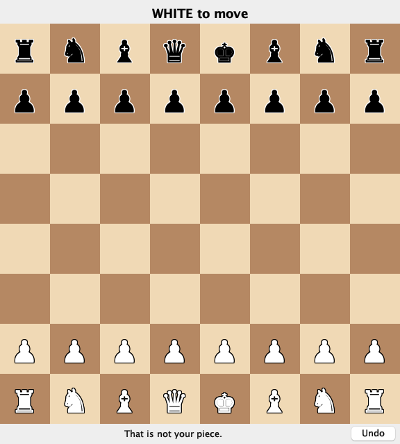

# Session 18 — Debugging

Session 2 said we would come back to the debugger in week 12. Until now you
have fixed bugs by reading the code and adding a print. That works on code
you just wrote. In M7 you will run a view you did not write, and a guess
about what it does is not worth much. This session gives you a method and
three tools: the stack trace, the debugger, and the log.

## 1. A method

Debugging is an experiment. Five steps, in order:

1. **Reproduce it.** Find the steps that make it fail every time.
2. **Read the evidence.** The exact message, the trace, the wrong value.
3. **Make one guess** you could prove wrong.
4. **Test the guess** by looking at the running program. Change nothing yet.
5. **Fix it, and keep a test** so that it can't come back unnoticed.

Most lost time comes from step 4 being skipped: changing code on a hunch,
running again, and changing something else.

## 2. Stack traces

Everything in sections 2–4 uses one small program, with no chess in it:
[`Playlist.java`](https://goleador.github.io/CSC413/lectures/session-18-debugging/demo/Playlist.java).
It has four bugs. To follow along in IntelliJ: **File → New → Project**,
choose Java and JDK 25, put `Playlist.java` in `src/`, and press the green
arrow beside `main`.

**What it should do.** `main` loads 40 tracks, each written as a title and a
length in minutes and seconds (`Track 07, 3:45`). It plays all 40 and carries
on, wrapping back to track 1. Then it adds two bonus tracks and prints the
length of all 42. Its last line prints the total you should get, so you can
compare. With every bug fixed, the output is:

```
Now playing: Track 01
Total: 189.5 minutes
Expected: 189.5 minutes
```

The first run:

```
Exception in thread "main" java.lang.IndexOutOfBoundsException: Index 40 out of bounds for length 40
	at java.base/jdk.internal.util.Preconditions.outOfBounds(Preconditions.java:100)
	at java.base/jdk.internal.util.Preconditions.outOfBoundsCheckIndex(Preconditions.java:106)
	at java.base/jdk.internal.util.Preconditions.checkIndex(Preconditions.java:302)
	at java.base/java.util.Objects.checkIndex(Objects.java:365)
	at java.base/java.util.ArrayList.get(ArrayList.java:428)
	at Playlist.next(Playlist.java:45)
	at Playlist.main(Playlist.java:79)
```

| Part | Here | Tells you |
|---|---|---|
| Thread | `"main"` | which thread failed |
| Exception type | `IndexOutOfBoundsException` | the kind of failure |
| Message | `Index 40 out of bounds for length 40` | the values involved |
| Frames | `at ...` | every call in progress, the most recent first |

A **thread** is one sequence of work a program is doing. Your programs so far
have had one, called `main`. A window adds another, which section 5 comes back
to. Each `at` line is a **frame**, one method call in progress.

Read from the bottom up and it is a story: `main` called `next`, `next`
called `ArrayList.get`, and `get` refused. Read the first line for what went
wrong. Then open **the first frame in your own code**, here
`Playlist.next`, line 45. In IntelliJ the file and line are a link.

Line 45 is correct:

```java
lastPlayed = songs.get(current);
```

The mistake is three lines above it, where the index should have wrapped:

```java
if (current > songs.size()) {
```

Index 40 is past the end of a list of 40, and `40 > 40` is false. It should
be `>=`. **A trace says where the program failed, and the mistake may be
earlier.**

### `Caused by`

With that fixed, the second run:

```
Exception in thread "main" java.lang.IllegalArgumentException: bad song line: Bonus 2, 3:5O
	at Playlist.parse(Playlist.java:35)
	at Playlist.load(Playlist.java:21)
	at Playlist.main(Playlist.java:83)
Caused by: java.lang.NumberFormatException: For input string: "5O"
	at java.base/java.lang.NumberFormatException.forInputString(NumberFormatException.java:67)
	at java.base/java.lang.Integer.parseInt(Integer.java:565)
	at java.base/java.lang.Integer.parseInt(Integer.java:662)
	at Playlist.parse(Playlist.java:32)
	... 2 more
```

Open line 35 of `parse`. It uses the `try`/`catch` from session 8, and passes
the first exception to the new one:

```java
} catch (NumberFormatException e) {
    throw new IllegalArgumentException("bad song line: " + line, e);
}
```

That second argument is what prints as `Caused by`.
The outer exception gives the context (which line of input), and the inner
one gives the original failure. Read
the last `Caused by` first; it is closest to the real problem. `... 2 more`
means the remaining frames are the same as those above.

The bug here is in the data: `3:5O` has a letter O in it. Change it to
`3:50`. A failure is not always in the code.

### What was null

A `NullPointerException` names the thing that was null. Call `nowPlaying()`
before any `next()`, and you get:

```
Exception in thread "main" java.lang.NullPointerException: Cannot invoke "Playlist$Song.title()" because "this.lastPlayed" is null
```

The question to ask next is why `lastPlayed` is null at that moment.

## 3. The debugger

The third run has no exception:

```
Now playing: Track 01
Total: 179.0 minutes
Expected: 189.5 minutes
```

A stack trace only exists when something throws. For a wrong answer you need
to watch the values.

**Breakpoints and stepping.** A **breakpoint** pauses the program at a line
you choose. The gutter is the margin down the left of the
editor, where the line numbers and the green arrow are. Click it beside line
60, `return total / 60;`, and a red dot marks a breakpoint. Then choose **Debug** instead of Run from the green arrow; Debug
runs the same program with the ability to pause. The program stops *before* running that line. The Debug window shows the
variables and the call stack.

| Action | macOS | Windows/Linux |
|---|---|---|
| Toggle a breakpoint | <kbd>Cmd</kbd>+<kbd>F8</kbd> | <kbd>Ctrl</kbd>+<kbd>F8</kbd> |
| Step over: run this line | <kbd>F8</kbd> | <kbd>F8</kbd> |
| Step into: enter the call on this line | <kbd>F7</kbd> | <kbd>F7</kbd> |
| Step out: finish this method | <kbd>Shift</kbd>+<kbd>F8</kbd> | <kbd>Shift</kbd>+<kbd>F8</kbd> |
| Resume until the next breakpoint | <kbd>Cmd</kbd>+<kbd>Opt</kbd>+<kbd>R</kbd> | <kbd>F9</kbd> |
| Evaluate an expression | <kbd>Opt</kbd>+<kbd>F8</kbd> | <kbd>Alt</kbd>+<kbd>F8</kbd> |

**Evaluate an expression** runs any Java expression in the paused program,
without changing the code. At line 60, `total` is `10770`:

| Expression | Value |
|---|---|
| `total / 60` | `179` |
| `total / 60.0` | `179.5` |

`total / 60` divides two `int`s, so the half minute is gone before the
result becomes a `double`. Change it to `60.0`, and the total is 179.5.

**Conditional breakpoints.** The total is still wrong, by exactly ten
minutes. There are forty-two songs, and one of them is longer than ten
minutes: track 37. That is a guess you can test: track 37 is losing ten
minutes when it is read.

Stepping through `load` would take 37 passes. Instead, right-click the
breakpoint on line 21, `songs.add(parse(line));`, and give it a condition, a
Java expression checked each time that line is reached. `line` is the loop
variable in `load`:

```java
line.startsWith("Track 37")
```

The program runs at full speed and stops only on that line of input. Now
step into `parse` with <kbd>F7</kbd> and step over to line 31:

```java
int minutes = Integer.parseInt(length.substring(colon - 1, colon));
```

`length` is `"12:30"` and `colon` is `2`. Evaluating
`length.substring(colon - 1, colon)` gives `"2"`, one digit. The minutes are
everything before the colon: `length.substring(0, colon)`. The total now
matches the expected 189.5.

**The call stack is live.** While paused in `parse`, the frames list shows
`parse`, `load`, `main`. Click `load` to see its variables at the moment it
made the call. That is how you find out who passed a bad value.

### Step 5: keep a test

A test is the bug written down as a small program that runs every time. Here
is the whole file,
[`PlaylistTest.java`](https://goleador.github.io/CSC413/lectures/session-18-debugging/demo/PlaylistTest.java).
It has the same shape as `PositionTest` from session 4: `@Test` on a method,
then `assertEquals` with the expected value first.

```java
import static org.junit.jupiter.api.Assertions.assertEquals;

import org.junit.jupiter.api.Test;

class PlaylistTest {

    @Test
    void readsTwoDigitMinutes() {
        assertEquals(750, Playlist.parse("Track 37, 12:30").seconds());
    }
}
```

750 is twelve and a half minutes in seconds. Against the unfixed `parse` it
fails with `expected: <750> but was: <150>`. It passes after the fix, so
nobody can bring that bug back without a test going red.

**Where JUnit comes from.** JUnit is not part of the JDK, so a project has to
bring it in. Your chess project does that in `pom.xml`, as session 2 described,
and Maven downloads it. The `Playlist` project is plain IntelliJ with no
`pom.xml`, so the two imports have nothing to point at yet.

| | Your chess project | The `Playlist` project |
|---|---|---|
| JUnit comes from | `pom.xml` | you add it, below |
| Tests live in | `src/test/java/...` | `src/`, beside `Playlist.java` |
| Run with | the green arrow, or `./mvnw test` | the green arrow |

**To add it to `Playlist`:**

1. Download `PlaylistTest.java` into `src/`, next to `Playlist.java`. `@Test`
   and the imports turn red, because IntelliJ can't find JUnit.
2. Click on `@Test` and press <kbd>Opt</kbd>+<kbd>Enter</kbd> (macOS) or
   <kbd>Alt</kbd>+<kbd>Enter</kbd> (Windows/Linux). That key asks IntelliJ what
   it can do about the problem under the cursor.
3. Choose **Add 'JUnit5...' to classpath** (the line includes a version number)
   and accept the dialog. The **classpath** is the list of places Java looks
   for classes; IntelliJ downloads JUnit and adds it to that list.
4. Press the green arrow beside `class PlaylistTest`.

If that menu line isn't offered, choose **File → Project Structure → Libraries
→ + → From Maven**, enter `org.junit.jupiter:junit-jupiter:5.12.2`, the version
your chess project uses, and add it to the module.

To see the test do its job, put `colon - 1, colon` back in `parse`, run the
test, and watch it fail. Then fix it again.

**To add a test to your chess project,** there is nothing to install, and
`pom.xml` must not change in M7. Put the new class under `src/test/java/`, in
the same package folder as the class it tests, with a name ending in `Test`.
Maven runs those classes; `./mvnw test` will count it. Writing tests well is
next week's topic.

## 4. Logging

A breakpoint looks at one run while you are watching. A log records what
happened when you weren't there, such as a bug on a classmate's machine.

You have probably added a `System.out.println` to find a bug. It has three
problems. You delete it afterwards and then need it again. It is all or
nothing, so you can't ask for only the problems. And in the model it breaks
session 16's dependency rule, because the model does not know a screen exists.

A **logger** is a `println` with two extras: every message has a level, and
you choose which levels appear without editing the code. Where the output goes
is a setting, which is why a logger is acceptable in the model.

### Levels

| Level | For | In `Playlist` |
|---|---|---|
| `SEVERE` | the program can't go on | the album can't be read |
| `WARNING` | something is wrong, and the program continues | one bad song line was skipped |
| `INFO` | ordinary events worth recording | 40 tracks loaded |
| `FINE` | details for debugging | `next: index=7` |

You choose a minimum level, and anything at or above it prints. The default
is `INFO`. A `FINE` line can stay in the code for good.

### Add one log line

`java.util.logging` comes with the JDK, so there is no `pom.xml` change. Add
these three lines to your `Playlist.java`:

```java
import java.util.logging.Logger;

public final class Playlist {
    private static final Logger LOG = Logger.getLogger(Playlist.class.getName());

    Song next() {
        current++;
        LOG.fine("next: index=" + current);
        // the rest of next() is unchanged
```

The `import` goes at the top of the file. Each class gets one `LOG` field, at
the top of the class. `getLogger` takes a name, and `Playlist.class.getName()`
gives the name of the class, here `Playlist`.

Run it. Nothing new prints, because `FINE` is below the default.

### Two things must allow `FINE`

```
LOG.fine(...)  →  the logger's level  →  the handler's level  →  your console
```

A **handler** is the part of the logging system that writes messages
somewhere. Ours writes to the console. (It is unrelated to a click handler.)
The logger has a level and so does the handler, and both stop at `INFO` by
default. Lowering only the logger shows nothing more.

We don't want to edit code to change this, so the settings go in a file.

### The settings file

A properties file is plain text with one `name=value` per line. Download
[`logging.properties`](https://goleador.github.io/CSC413/lectures/session-18-debugging/demo/logging.properties):

```
handlers=java.util.logging.ConsoleHandler
.level=INFO
java.util.logging.ConsoleHandler.level=FINE
Playlist.level=FINE
```

| Line | Means |
|---|---|
| `handlers=...ConsoleHandler` | write to the console |
| `.level=INFO` | every logger: `INFO` and up |
| `...ConsoleHandler.level=FINE` | the handler lets `FINE` through |
| `Playlist.level=FINE` | the logger named `Playlist`: `FINE` and up |

`Playlist` here is the name you passed to `getLogger`.

### Telling Java where the file is

Java doesn't look for this file by itself. You've already typed a command with
the two kinds of input in it; this one has a setting added:

```bash
java -Djava.util.logging.config.file=logging.properties -cp target/classes edu.sfsu.csc413.chess.Main swing
```

| Where | Called | Goes to |
|---|---|---|
| Before the class name | VM options | Java itself |
| After the class name | program arguments | `main`'s `args`, like `swing` |

`-cp` is a VM option you already use: it sets the classpath, the list of places
Java looks for classes.
`-D` sets a named value that Java can read while it runs. The logging system
looks up the value called `java.util.logging.config.file` and opens that file.

When you press the green arrow, IntelliJ builds this command for you, so it
has a separate box for each kind.

1. Save `logging.properties` in the project folder, next to `src/`, not inside
   it.
2. Choose **Run → Edit Configurations**, then pick `Playlist` on the left. (It
   is listed once you've run the program.) Choose **Modify options → Add VM
   options**, and paste this into the box labelled **VM options**, not
   **Program arguments**:

   ```
   -Djava.util.logging.config.file=logging.properties
   ```

3. Run it:

```
Nov 08, 2026 6:47:03 PM Playlist next
FINE: next: index=0
Nov 08, 2026 6:47:03 PM Playlist next
FINE: next: index=1
```

**How Java finds the file.** The value is an ordinary file path, and a
relative path starts in the folder the program runs from. It is the same idea
as `pwd` from session 2. IntelliJ calls that folder the **working directory**
and shows it in the same Edit Configurations dialog. Copying the file into
`src/` doesn't help, because `-cp` is for finding classes and this is not a
class. If the working directory isn't the folder holding the file, move the
file or give a full path.

| What you see | What went wrong |
|---|---|
| No log lines at all, not even `INFO`, and no error | Java couldn't find the file. Check the path against the working directory. |
| `INFO` but no `FINE`, the same as before | The flag never reached Java: it's in Program arguments, or after the class name. Or the name in the file doesn't match the logger's name. |

### Where a log line goes

Go back to the bugs you fixed. If each had happened on someone else's machine,
what single line of output would have told you?

| The bug | The line that would have shown it | Where |
|---|---|---|
| The index ran past the end | `"next: index=" + current` | where a value changes |
| `3:5O` in the data | `"loading: " + line` | where data comes in |
| Track 37 lost ten minutes | `"parsed: " + line + " = " + minutes` | where data is converted |

Log the values you would have looked at in the debugger. `"got here"` tells
you nothing next month. Inside a loop that runs thousands of times, use `FINE`
at most. If you throw an exception, don't log it as well; whoever catches it
decides.

`WARNING` is for a problem the program survives. The second run died on one
typo in the data. With the `try`/`catch` from session 8, `load` can skip that
line instead and say so:

```java
for (String line : lines) {
    LOG.fine("loading: " + line);
    try {
        songs.add(parse(line));
    } catch (IllegalArgumentException e) {
        LOG.warning("skipping " + line);
    }
}
```

Put the letter O back in the `Bonus 2` line in `main` and run it. `WARNING` is above `INFO`, so it
prints with no settings changed:

```
Nov 08, 2026 6:47:03 PM Playlist load
WARNING: skipping Bonus 2, 3:5O
```

Whether to skip or stop is a design choice. A playlist can lose a song; a bank
transfer should stop.

**In your chess project** the logging file goes beside `pom.xml`, and the
logger's name includes its package: for example
`edu.sfsu.csc413.chess.view.SwingView.level=FINE`. The short name
`SwingView.level` matches nothing. For M7, keep the file outside your
repository and give its full path, because `git add -A` would otherwise commit
it and it isn't on the handout's list of files the diff may show. Log only in
your view, since the model and `GameController` must not change: the start of
the click handler, just before `controller.handle(...)`, and the start of
`render`.

**Which tool?**

| Situation | Reach for |
|---|---|
| A crash you can repeat | the stack trace |
| A wrong value you can repeat | a breakpoint |
| A failure you can't watch: another machine, once a day | a log |
| A bug you fixed and never want back | a test |

## 5. Code you did not write

The view generated in session 17 works. For this section we add one bug at a
time, so there is something to find.

### Read it by following one action

Don't read a generated class from the top. Pick one thing a user does and
follow it. For a click in the view generated in session 17:

1. Swing calls `BoardPanel`'s `mousePressed` when the mouse button goes down.
   It turns the pixels of the click into a `Position`.
2. `squareClicked` remembers the first click, and on the second builds
   a notation like `e2e4`.
3. It calls `controller.handle(new PlayerAction.Move(notation))`.
4. The controller calls `render`, which redraws.

Session 16's three questions still sort each line: is it a rule, is it what
the user sees, or does it take a request?

| Question | IntelliJ | macOS | Windows/Linux |
|---|---|---|---|
| Where is this defined? | Go to Declaration | <kbd>Cmd</kbd>+click | <kbd>Ctrl</kbd>+click |
| Who calls this? | Find Usages | <kbd>Opt</kbd>+<kbd>F7</kbd> | <kbd>Alt</kbd>+<kbd>F7</kbd> |
| Which class implements this? | Go to Implementation | <kbd>Cmd</kbd>+<kbd>Opt</kbd>+<kbd>B</kbd> | <kbd>Ctrl</kbd>+<kbd>Alt</kbd>+<kbd>B</kbd> |
| How did we get here? | Call Hierarchy | <kbd>Ctrl</kbd>+<kbd>Opt</kbd>+<kbd>H</kbd> | <kbd>Ctrl</kbd>+<kbd>Alt</kbd>+<kbd>H</kbd> |

### A window that waits

Session 17's excerpt C, added to the view and run for real: `start` builds the window and then
calls `controller.runLoop()`.

```
Exception in thread "main" java.lang.UnsupportedOperationException: SwingView is event-driven, so it does not answer nextAction(). Did it call runLoop() by mistake?
	at edu.sfsu.csc413.chess.view.BoardView.nextAction(BoardView.java:58)
	at edu.sfsu.csc413.chess.view.GameController.runLoop(GameController.java:58)
	at edu.sfsu.csc413.chess.view.swing.SwingView.start(SwingView.java:86)
	at edu.sfsu.csc413.chess.view.GameController.start(GameController.java:45)
	at edu.sfsu.csc413.chess.Main.main(Main.java:16)
```

The top frame is where the exception was thrown on purpose, and the mistake
is the third frame: `SwingView.start`, line 86.

`runLoop` keeps asking the view for the next typed move, and a window has no
typed moves, so `BoardView` throws on purpose.

That is one possible result. Session 16 said Swing handles clicks and drawing
on its own thread. In a trace that thread is named `AWT-EventQueue-0`, and it
runs alongside `main`. This same program, unchanged, was run twelve times:

| Runs | Printed |
|---|---|
| 5 | the message above, on `main` |
| 4 | a `NullPointerException` from `Board.kingPosition` on `AWT-EventQueue-0`, then the message above |
| 3 | a `NullPointerException` from `Board.kingPosition` on `main` |

The `NullPointerException` traces lead into the model, which has no bug.
Two threads were calling `game.status()` on the same `Game` at the same
moment: `main`, through `runLoop`, and Swing's event thread, through
`render`. The model wasn't written for that.

**If the failure changes from run to run on the same code, suspect two
threads.** Don't start with the frame at the top, and don't fix the model.
Ask which threads are using the object. Here it comes back to the rule from
session 16: a window's `start` builds the window and returns.

### An exception inside a click

A one-line change to `squareClicked` clears the selection before using it:

```java
selected = null;
String notation = selected.toString() + clicked;
```

Select a piece, click where it should go, and nothing happens on the board.
In the console:

```
Exception in thread "AWT-EventQueue-0" java.lang.NullPointerException: Cannot invoke "edu.sfsu.csc413.chess.model.Position.toString()" because "this.selected" is null
	at edu.sfsu.csc413.chess.view.swing.SwingView.squareClicked(SwingView.java:141)
	at edu.sfsu.csc413.chess.view.swing.SwingView$BoardPanel$1.mousePressed(SwingView.java:168)
	at java.desktop/java.awt.Component.processMouseEvent(Component.java:6573)
	... about twenty more lines inside java.desktop
```

Two things are different from a console program. `AWT-EventQueue-0` is
Swing's event thread, the one that runs your click handlers. **An exception
there ends that one event and the window keeps running**, so a bug can look
like a click that did nothing. Keep the console open while you test a
window.

The second difference is the long tail of library frames. The method is the
same: find the first frame in the code you are working on.

### A wrong answer in a window

Another one-line change:

```java
int rank = e.getY() / SQUARE;
```



The board is drawn correctly, and clicking the white pawn on e2 says "That
is not your piece." Either the model has the wrong idea of the board, or
the view has the wrong idea of the click.

A breakpoint in `squareClicked` shows `clicked` is e7, so the model is
answering correctly about the square it was asked about. Clicking the
`mousePressed` frame, one up the stack, shows `e.getY() / SQUARE` is 6.
Screen rows count down from the top; ranks count up from the bottom. The
correct line is:

```java
int rank = 7 - e.getY() / SQUARE;
```

While a breakpoint has the event thread paused, the window can't repaint or
respond. That is expected.

## 6. M7

M7 opens today and is due **Monday, November 16**.
[Read the handout](https://goleador.github.io/CSC413/guide.html?d=assignments/m7-views/handout).
Session 17 explained how it works. Four things to notice in the handout:

- **`m7-submission.md` asks for debugger evidence.** If a view had a real bug:
  the symptom, the evidence (a frame, a breakpoint, or a log line), the cause,
  and the fix. The agent may well get it right. If you find no bug, follow one
  move through your click handler with a breakpoint, and report what you
  predicted and which values you saw.
- **Your review counts "kept" the same as a fix**, if you say how you checked it.
- **One change is by hand**, in a commit starting `M7 by hand:`.
- **Push your run branches.** `git push origin main --tags` doesn't push
  them: `git push origin main m7-run-1 --tags`, listing each one.

## Exercises

1. **What was null.** Call `nowPlaying()` before `next()` in `Playlist`. Fix
   it so an unstarted playlist has a sensible answer. What should it return?
2. **Stop on the data.** Set a conditional breakpoint in `totalMinutes` that
   stops only on a song longer than five minutes. Which song is first?
3. **From print to log.** Add a `FINE` line to `load` recording each song
   parsed. Run it with the logging off, then on.
4. **A trace from your engine.** Make a test in your repository fail on
   purpose by passing `null` to one of your constructors. Which frame do you
   open first? Undo it afterwards.
5. **Follow one action.** In a generated view of yours, follow the Undo button
   from the click to the redraw. List each method.
6. **Two threads.** In the table of twelve runs, why does the
   `UnsupportedOperationException` appear in nine runs and not all twelve?

## Exit question

> A weather app shows yesterday's forecast, with no exception. What do you
> do first? A breakpoint, a log line, or a test, and why?

## Related material

- [Session 16 notes](https://goleador.github.io/CSC413/guide.html?d=lectures/session-16-mvc/notes):
  the three questions, and "never wait inside a click".
- [Session 17 notes](https://goleador.github.io/CSC413/guide.html?d=lectures/session-17-ai-views/notes):
  reviewing generated code and comparing runs.
- [M7 handout](https://goleador.github.io/CSC413/guide.html?d=assignments/m7-views/handout).
- [IntelliJ's debugging documentation](https://www.jetbrains.com/help/idea/debugging-code.html).
