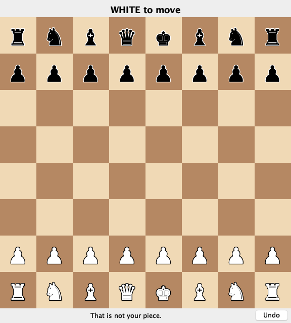

**CSC 413 · Week 12 · Monday Nov 9**

# Debugging

### Stack traces, the debugger, logging, and reading code you did not write

San Francisco State University

> Open IntelliJ if you have your laptop. M6 is due tonight at 11:59, and M7 opens today. There is no class Wednesday, Veterans Day.

---

## Why today

In M7 you run a view you did not write.

*(reveal)* A guess about what it does isn't worth much. Look at it running.

> Until now you've fixed bugs in code you just wrote, so you remembered what it was meant to do. How did you find your last bug? Today you get a method and three tools for when you don't have that memory.

---

## Debugging is an experiment
- **Reproduce** it.
- **Read** the evidence.
- **Guess**, in a way you could disprove.
- **Test** the guess. Change nothing yet.
- **Fix** it, and keep a test.

> Most lost time comes from skipping step 4: change something on a hunch, run it, change something else. We'll use these five steps on every bug today.

---

# Stack traces

> You've been reading these since M0b. Today we read them on purpose.

---

## Follow along
- Notes §2: download `Playlist.java`.
- **File → New → Project**: Java, JDK 25.
- Put it in `src/`.
- Press the green arrow beside `main`.

> It's a small program with four bugs and no chess. Pair up with a neighbour if you don't have a laptop. Keep it in a new project, so none of this lands in your chess repository.

---

## What `Playlist` should do
- Load 40 tracks: `Track 07, 3:45`.
- Play them, wrapping back to track 1.
- Add two bonus tracks; total the minutes.

A correct run:

```
Now playing: Track 01
Total: 189.5 minutes
Expected: 189.5 minutes
```

> Before we run it, here's what it's supposed to do, because you can't call something a bug until you know what right looks like. Ask: in Track 07, 3:45, what's the 3:45? Title, then minutes and seconds. This is the output with all four bugs fixed. Yours won't look like this yet.

---

## The first run

```
Exception in thread "main" java.lang.IndexOutOfBoundsException: Index 40 out of bounds for length 40
    at java.base/jdk.internal.util.Preconditions.outOfBounds(Preconditions.java:100)
    at java.base/jdk.internal.util.Preconditions.outOfBoundsCheckIndex(Preconditions.java:106)
    at java.base/jdk.internal.util.Preconditions.checkIndex(Preconditions.java:302)
    at java.base/java.util.Objects.checkIndex(Objects.java:365)
    at java.base/java.util.ArrayList.get(ArrayList.java:428)
    at Playlist.next(Playlist.java:45)
    at Playlist.main(Playlist.java:79)
```

Which line do you open first?

*(reveal)* The first frame in your own code: `Playlist.next`, line 45.

> Ask a few people before revealing. Everything above that frame is the library doing its job. In IntelliJ the file and line are a link; click it.

---

## What's in a trace
| Part | Here | Tells you |
|---|---|---|
| Thread | `"main"` | which running thread failed |
| Exception type | `IndexOutOfBoundsException` | the kind of failure |
| Message | `Index 40 out of bounds for length 40` | the values involved |
| Frames | `at …` | one line per call in progress, most recent first |

> Read from the bottom up and it's a story: main called next, next called get, get refused. Read the top for what went wrong. Session 7 did this with a scaffold that threw. A thread is one sequence of work the program is doing; so far your programs have had one, called main, and windows will add another. Each line starting with at is called a frame.

---

## Line 45 is correct

```java
Song next() {
    current++;
    if (current > songs.size()) {
        current = 0;
    }
    lastPlayed = songs.get(current);
    return lastPlayed;
}
```

*(reveal)* A trace says where the program failed. The mistake may be earlier.

> Where's the actual mistake? Index 40, length 40, and 40 greater than 40 is false. Change it to greater-or-equal and run again.

---

## The second run

```
Exception in thread "main" java.lang.IllegalArgumentException: bad song line: Bonus 2, 3:5O
    at Playlist.parse(Playlist.java:35)
    at Playlist.load(Playlist.java:21)
    at Playlist.main(Playlist.java:83)
Caused by: java.lang.NumberFormatException: For input string: "5O"
    at java.base/java.lang.NumberFormatException.forInputString(NumberFormatException.java:67)
    at java.base/java.lang.Integer.parseInt(Integer.java:565)
    at java.base/java.lang.Integer.parseInt(Integer.java:662)
    at Playlist.parse(Playlist.java:32)
    ... 2 more
```

*(reveal)* Read the last `Caused by` first: closest to the problem.

*(reveal)* The bug is in the data: a letter O.

> Click line 35. parse catches the NumberFormatException with session 8's try/catch and throws a new exception, passing the first one along; that's what prints as Caused by. The outer one has the context, the inner one the original failure, and "2 more" means the same frames as above. Not every failure is in the code. Fix the O and run again.

---

## The message says what was null

Call `nowPlaying()` before any `next()`:

```
java.lang.NullPointerException: Cannot invoke "Playlist$Song.title()"
    because "this.lastPlayed" is null
```

*(reveal)* Next question: why is it null at this moment?

> You met NullPointerException in earlier milestones; here Java names the exact thing that was null. Playlist$Song is how Java writes the Song record nested inside Playlist. It's the first exercise in the notes.

---

# The debugger

> Session 2 promised this for week 12. Keep following along on your own machine.

---

## The third run

```
Now playing: Track 01
Total: 179.0 minutes
Expected: 189.5 minutes
```

*(reveal)* No exception, so no trace. To find a wrong answer, watch the values.

> What would you do first? Most of us would add a print. Today we'll stop the program and look instead.

---

## Stop the program and look

A **breakpoint** pauses the program at a line you choose.
- In the gutter, the line-number margin, click line 60.
- Green arrow → **Debug**.
- It stops *before* running that line.

> The gutter is the strip down the left of the editor, with the line numbers. It's where the green arrow lives. Line 60 is return total / 60. Clicking there puts a red dot on the line: that's a breakpoint. Debug is Run with the ability to pause. Everyone do this now, and look at the Variables pane. I'll wait until most of the room has it stopped. Hands up if yours didn't stop.

---

## The keys
| Action | macOS | Windows/Linux |
|---|---|---|
| Toggle a breakpoint | Cmd+F8 | Ctrl+F8 |
| **Step over**: run this line | F8 | F8 |
| **Step into**: enter the call | F7 | F7 |
| **Step out**: finish this method | Shift+F8 | Shift+F8 |
| Resume | Cmd+Opt+R | F9 |
| Evaluate an expression | Opt+F8 | Alt+F8 |

> These are also in the notes. The buttons on the Debug toolbar do the same thing if you can't remember the keys.

---

## Evaluate, without changing the code

`total` is `10770`. What is each one?
| Expression | Value |
|---|---|
| `total / 60` | *(reveal)* `179` |
| `total / 60.0` | *(reveal)* `179.5` |

*(reveal)* Two `int`s divide as integers. The half minute is gone before it becomes a `double`.

> Predict first, then evaluate each one in your own debugger. Change the line to 60.0, stop the session, and run it again.

---

## Now it says 179.5

It should say 189.5. What's your guess?

*(reveal)* Exactly ten minutes are missing. Only track 37 is over ten minutes long.

> Take guesses from the room. A guess has to be something you could prove wrong. Ours is: track 37 loses ten minutes when it's read.

---

## Stop on the data that fails

```java
songs.add(parse(line));
```

Line 21 reads every track. We want only track 37. Right-click its breakpoint. Condition:

```java
line.startsWith("Track 37")
```

*(reveal)* It runs at full speed and stops once, instead of 37 times.

> Remove the old breakpoint and set this one. The condition is a Java expression, checked each time the line is reached, and line is the loop variable in load. Debug it. When it stops, check that line says Track 37, then press F7 to step into parse.

---

## What will `minutes` be?

```java
int colon = length.indexOf(':');
int minutes = Integer.parseInt(length.substring(colon - 1, colon));
```

`length` is `"12:30"`, and `colon` is `2`.

*(reveal)* `2`. The substring is one digit. It should be `length.substring(0, colon)`.

> Step over with F8 until you've run the minutes line, and check your prediction. While you're paused, click load in the frames list: you can see its variables too. Then make the fix; the total now matches the expected 189.5.

---

## Step 5: keep a test

```java
import static org.junit.jupiter.api.Assertions.assertEquals;

import org.junit.jupiter.api.Test;

class PlaylistTest {

    @Test
    void readsTwoDigitMinutes() {
        assertEquals(750, Playlist.parse("Track 37, 12:30").seconds());
    }
}
```

```
expected: <750> but was: <150>
```

*(reveal)* It fails without the fix, so it can catch this bug again.

> Same shape as PositionTest in session 4: @Test on a method, then assertEquals with the expected value first. 750 is twelve and a half minutes in seconds, and the buggy code gave 150. Why write it after we've fixed the bug? So nobody can bring it back without a test going red.

---

## Where did JUnit come from?
|  | Your chess project | This project |
|---|---|---|
| JUnit comes from | `pom.xml` | nowhere yet |
| Tests live in | `src/test/java/…` | `src/`, beside `Playlist.java` |
| Run with | green arrow, or `./mvnw test` | green arrow |

*(reveal)* JUnit isn't part of the JDK, so a project has to bring it in.

> Until now pom.xml has done this for you; session 2 said it lists JUnit as a dependency, and Maven downloads it. Our Playlist project is plain IntelliJ with no pom.xml, so those two imports have nothing to point at.

---

## Add JUnit and run the test
- Download `PlaylistTest.java` into `src/`. `@Test` turns red.
- Click `@Test`; press Opt+Enter or Alt+Enter.
- Choose **Add JUnit to classpath**.
- Green arrow beside the class.

> Red means IntelliJ can't find it. Opt or Alt plus Enter asks IntelliJ what it can do about the problem under the cursor; it's worth knowing everywhere. The classpath is the list of places Java looks for classes, so this puts JUnit on that list. The exact menu line includes a version number. Now put colon minus one back in parse, run the test, and watch it fail with our 150. Then fix it again and watch it pass.

---

# Logging

> A breakpoint looks at one run while you're watching. A log records what happened when you weren't there, like a bug on a classmate's machine.

---

## Why not `println`?
- You delete it afterwards, then need it again.
- All or nothing: you can't ask for only the problems.
- In the model, it breaks the dependency rule.

> Who added a println to find a bug in M5 or M6, then deleted it? A logger is a println with two extras: every message has a level, and you choose which levels appear without editing the code. Session 16's exercise had System.out in Game as a rule break; where a logger's output goes is a setting, so the model still doesn't know a screen exists.

---

## A logger gives each message a level
| Level | For | In Playlist |
|---|---|---|
| `SEVERE` | the program can't go on | the album can't be read |
| `WARNING` | something's wrong, and it continues | one bad song line was skipped |
| `INFO` | ordinary events worth recording | 40 tracks loaded |
| `FINE` | details for debugging | `next: index=7` |

*(reveal)* You choose a minimum level. The default is `INFO`.

> Ask: which of these would you want on every run, and which only when you're hunting a bug? That's why there's a minimum: anything at that level or above prints, and the rest is ignored. The FINE lines can stay in the code for good.

---

## Add one log line

```java
import java.util.logging.Logger;

public final class Playlist {
    private static final Logger LOG = Logger.getLogger(Playlist.class.getName());

    Song next() {
        current++;
        LOG.fine("next: index=" + current);
```

Run it. What prints?

*(reveal)* Nothing new: `FINE` is below the default, `INFO`.

> Add these three lines to your Playlist now. The LOG field is static final, like the constants you've written, and every class gets its own. getLogger takes a name, and Playlist.class.getName() gives "Playlist", which we'll need in a minute. Predict before you run.

---

## Two things must allow `FINE`

```java
LOG.fine(...)  →  the logger's level  →  the handler's level  →  your console
```

A **handler** is the part that writes messages somewhere. Ours writes to the console.

*(reveal)* Both stop at `INFO` by default, so we must lower both.

> This isn't a click handler from session 16; same word, different job. The logger decides whether a message counts, and the handler decides whether to write it. Most people lower only the logger, see nothing, and conclude logging is broken. We don't want to edit code to change this, so the settings go in a file.

---

## `logging.properties`: settings in a file

A properties file is plain text: one `name=value` per line.
| Line | Means |
|---|---|
| `handlers=java.util.logging.ConsoleHandler` | write to the console |
| `.level=INFO` | every logger: `INFO` and up |
| `java.util.logging.ConsoleHandler.level=FINE` | the handler lets `FINE` through |
| `Playlist.level=FINE` | the `Playlist` logger: `FINE` and up |

> Which two lines are the two gates from the last slide? Lines three and four. Playlist.level uses the name we passed to getLogger; that's why the name mattered. Download the file from the week page, but Java won't look for it by itself: we have to tell it where it is.

---

## Telling Java: a VM option

```java
java -Djava.util.logging.config.file=logging.properties -cp target/classes edu.sfsu.csc413.chess.Main swing
```
| Where | Called | Goes to |
|---|---|---|
| Before the class name | VM options | Java itself |
| After the class name | program arguments | `main`'s `args` |

*(reveal)* `-D` sets a named value that Java can read while it runs.

> You've typed most of this in M6: the word emoji or swing at the end lands in args. -cp is a VM option too; it tells Java where your classes are. The logging system looks up a value called java.util.logging.config.file, and -D is how we set it. IntelliJ builds this command for you when you press the arrow, so it has a box for each kind.

---

## Where the file goes
- Save `logging.properties` in the project folder, beside `src/`.
- **Run → Edit Configurations → Modify options → Add VM options**.
- Paste into **VM options**:

```java
-Djava.util.logging.config.file=logging.properties
```

> Everyone do this now. Drag the file onto the project folder, not onto src. The box says VM options; Program arguments would hand it to main, and nothing changes. Run it, and hands up if you see FINE lines.

---

## Every log line vanished

You added the VM option. Even `INFO` is gone. Why?

*(reveal)* Java can't find the file, and it says nothing.

*(reveal)* A relative path starts in the folder the program runs from.

> Ask first. It's the same idea as pwd from session 2: a relative path starts where you are. IntelliJ calls that folder the working directory, and it's in the Edit Configurations dialog. This is an ordinary file path, not a class lookup, so copying the file into src doesn't help.

---

## Where a log line goes
| The bug we fixed | The line that would have shown it | Where |
|---|---|---|
| Index ran past the end | `"next: index=" + current` | where a value changes |
| `3:5O` in the data | `"loading: " + line` | where data comes in |
| Track 37 lost ten minutes | `"parsed: " + line + " = " + minutes` | where data is converted |

*(reveal)* Log the values you would have looked at in the debugger.

> Take each bug: if this had happened on someone else's machine, what single line of output would have told you? Those are the places a log line earns its keep. "Got here" tells you nothing next month; a value does.

---

## One bad line, one warning

```java
LOG.fine("loading: " + line);
try {
    songs.add(parse(line));
} catch (IllegalArgumentException e) {
    LOG.warning("skipping " + line);
}
```

The second run died on one typo. Should it?

*(reveal)* Now it skips that line and says so. `WARNING` prints with no settings changed.

> Try/catch is session 8's. parse throws IllegalArgumentException, the exception from our second run, and here load decides one bad line shouldn't lose the album. It's a design choice: ask who'd prefer the crash. Put the letter O back in the Bonus 2 line to see it, or try it after class.

---

## Which tool?
| Situation | Reach for |
|---|---|
| A crash you can repeat | *(reveal)* the stack trace |
| A wrong value you can repeat | *(reveal)* a breakpoint |
| A failure on someone else's machine | *(reveal)* a log |
| A bug you fixed and never want back | *(reveal)* a test |

> Ask for each row before revealing it. There's more than one defensible answer for some of these; ask why.

---

# Code you did not write

> Now the same tools on the Swing view an agent generated on Wednesday. That view works. I added one bug at a time so we have something to find.

---

## Follow one click
- `mousePressed`: pixels become a `Position`.
- `squareClicked`: first click remembered; second builds `e2e4`.
- `controller.handle(new PlayerAction.Move(notation))`
- The controller calls `render`.

*(reveal)* Follow one action, not the file.

> Swing calls mousePressed for you when the mouse button goes down, the same inversion as session 16: the window calls us. Which of session 16's three questions does each step answer? This is 234 lines an agent wrote; nobody needs to read it in order.

---

## Getting around in IntelliJ
| Question | Action | macOS | Windows/Linux |
|---|---|---|---|
| Where is this defined? | Go to Declaration | Cmd+click | Ctrl+click |
| Who calls this? | Find Usages | Opt+F7 | Alt+F7 |
| Who implements this? | Go to Implementation | Cmd+Opt+B | Ctrl+Alt+B |
| How did we get here? | Call Hierarchy | Ctrl+Opt+H | Ctrl+Alt+H |

> Find Usages on squareClicked, and Go to Implementation on BoardView.render. You used Cmd-click in session 2.

---

## A window that waits

```
Exception in thread "main" java.lang.UnsupportedOperationException: SwingView is event-driven…
    at …view.BoardView.nextAction(BoardView.java:58)
    at …view.GameController.runLoop(GameController.java:58)
    at …view.swing.SwingView.start(SwingView.java:86)
    at …view.GameController.start(GameController.java:45)
    at …Main.main(Main.java:16)
```

Which frame is the mistake?

*(reveal)* `SwingView.start`, line 86: a window called `runLoop`.

> This is excerpt C from Wednesday, added to the view and run for real. runLoop keeps asking the view for the next typed move, and a window has no typed moves. The top frame threw on purpose; session 16's rule is what got broken, and it's two frames down.

---

## The same code, run twelve times
| Runs | Printed |
|---|---|
| 5 | the message on the last slide, on `main` |
| 4 | a `NullPointerException` in `Board.kingPosition` on Swing's thread, then that message |
| 3 | a `NullPointerException` in `Board.kingPosition` on `main` |

Why would the same code fail differently?

*(reveal)* Two threads called `game.status()` at once. If failures change between runs, suspect two threads.

> Same code, no edits between runs. Session 16 said Swing handles clicks and drawing on its own thread, named AWT-EventQueue-0 in a trace, while main keeps going. The model has no bug, and fixing it would be the wrong move. main is in runLoop and Swing's thread is in render, both inside one Game, and it wasn't written for that.

---

## An exception inside a click

```
Exception in thread "AWT-EventQueue-0" java.lang.NullPointerException:
  Cannot invoke "…Position.toString()" because "this.selected" is null
    at …view.swing.SwingView.squareClicked(SwingView.java:141)
    at …view.swing.SwingView$BoardPanel$1.mousePressed(SwingView.java:168)
    at java.desktop/java.awt.Component.processMouseEvent(Component.java:6573)
    … about twenty more lines inside java.desktop
```

What does the player see?

*(reveal)* A click that did nothing. The window keeps running, so keep the console open.

> Same thread as the last slide: AWT-EventQueue-0 is Swing's. An exception there ends one event and nothing else. Let's look at the code at line 141 and find it.

---

## A wrong answer in a window



I clicked the white pawn on e2.

Who is wrong: the model or the view?

*(reveal)* Don't guess. Stop in `squareClicked` and look at `clicked`.

> Vote by hand: model or view? Then I'll set the breakpoint and we'll find out. Remember step 4: change nothing yet.

---

## One frame up

```java
int file = e.getX() / SQUARE;
int rank = e.getY() / SQUARE;
```

`SQUARE` is one square's size in pixels. `clicked` is e7, and `e.getY() / SQUARE` is `6`.

*(reveal)* Screen rows count down. Ranks count up.

*(reveal)*

```java
int rank = 7 - e.getY() / SQUARE;
```

> e.getY() is how many pixels down the window you clicked, so the division gives the row from the top. The model was right about the square it was asked about. Clicking the mousePressed frame shows where the wrong value came from. While a breakpoint has the event thread paused, the window can't repaint; that's expected.

---

# M7

> Opens today. Session 17 explained how it works, so this is only what's in the handout.

---

## M7: due Monday, November 16
- Swing plus one more view, behind `BoardView`.
- Groups of 1–3.
- **New:** debugger evidence from your own view.
- **New:** one change by hand.

> The handout is on the week 12 page. The two new items are what today was for: you'll use these tools on code you didn't write, and show you can change it yourself. The agent may well get it right. If you find no bug, follow one move through your click handler with a breakpoint and report what you saw.

---

## Push your run branches

```bash
git tag submit-m7
git push origin main m7-run-1 --tags
```

*(reveal)* `--tags` does not push branches. List every run.

> If the branches aren't on GitHub, your comparison can't be checked. Finish M6 first if you haven't. An agent still may not touch your controller.

---

## Exit question

> A weather app shows yesterday's forecast, with no exception. What do you do first? A breakpoint, a log line, or a test, and why?

> Tell your neighbour, then I'll ask two or three of you. The first thing should be reproducing it, and any tool works with a reason.

---

# Next: Monday Nov 16

## Unit testing with JUnit

M6 is due tonight. M7 is due Nov 16. No class Wednesday.

> Veterans Day Wednesday. See you next Monday.
